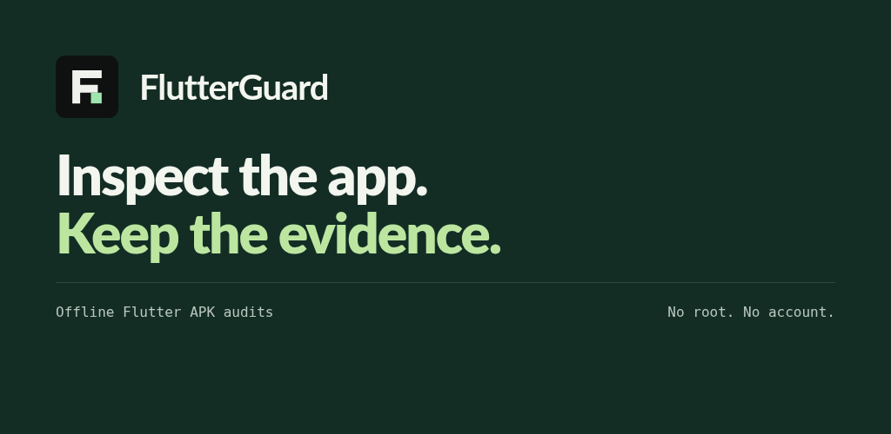
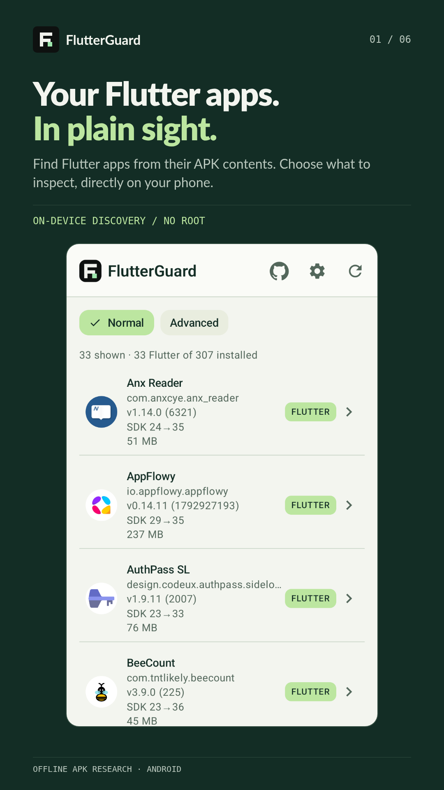
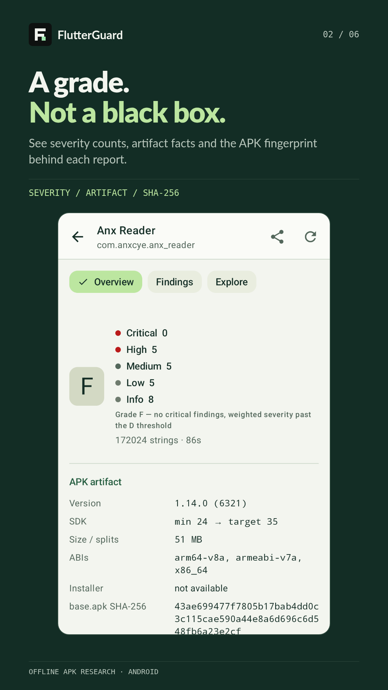
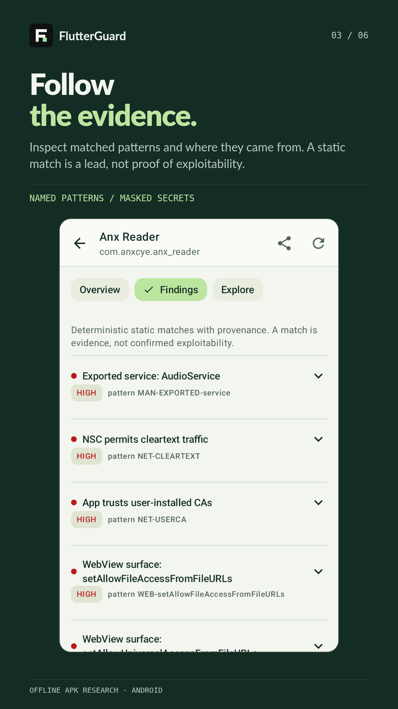
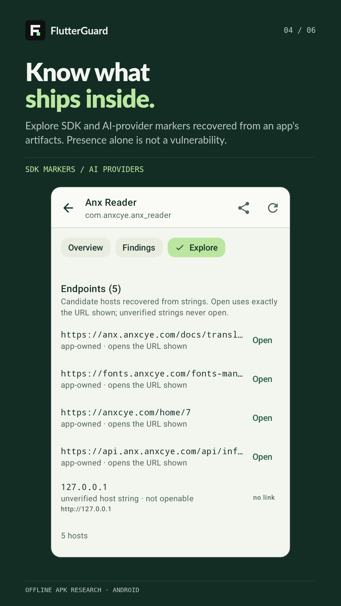
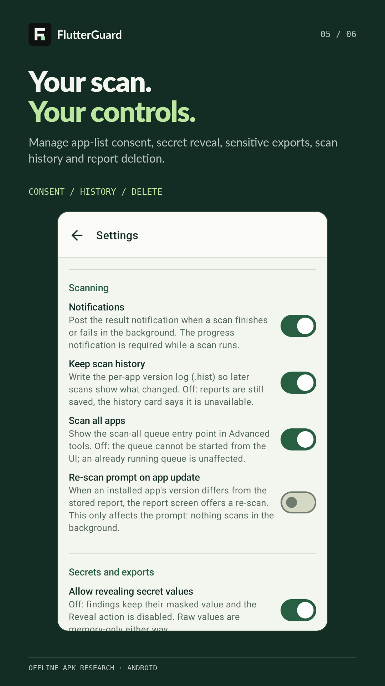
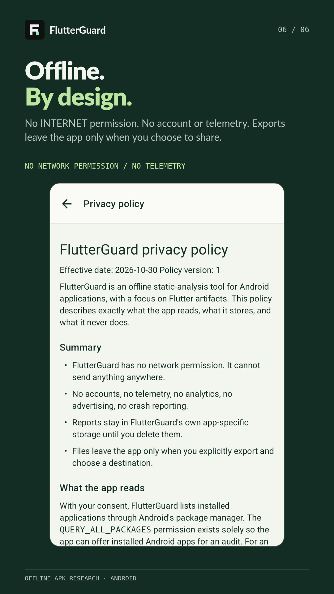

<div align="center">


# FlutterGuard

**See what ships inside a Flutter app.**

Open an installed Flutter app, or a single APK, and read its libraries, endpoints and exposed
strings. The whole audit runs on your phone: no uploads, no account, no setup.

[](https://github.com/anasfik/flutterguard/releases)
[](LICENSE)
[](#install)
[](#privacy)

**[Download the APK](https://github.com/anasfik/FlutterGuard/releases/latest) ·
[Website](https://flutterguard.dev) ·
[Guides](https://flutterguard.dev/#guides) ·
[Privacy](https://gwhyyy.com/privacy/flutterguard)**



</div>

---

## Worth knowing first

A permissions screen only tells you what an app asks for. A Flutter release keeps most of its real
surface somewhere else: the compiled library, the asset bundle, the manifests and policy files
inside the package.

FlutterGuard reads those layers and puts them into one readable report, so you can decide for
yourself what deserves a closer look.

It is free, open source, and it never sends your data anywhere.

## Screenshots

| App inventory | Report grade | Findings |
|---|---|---|
|  |  |  |

| Endpoints and routes | Settings | Privacy |
|---|---|---|
|  |  |  |

## What a scan shows you

- **Libraries** — the building blocks it can identify, with version evidence when the release
  keeps it.
- **Connections** — endpoints, domains and AI-provider markers left in the package.
- **Exposed strings** — secret-pattern matches, with values masked until you choose to reveal them.
- **Package policy** — permissions, signing information and network-security configuration.
- **App structure** — Flutter assets and candidate route strings, kept as clues rather than
  pretend navigation.
- **Reports** — saved on the phone, ready to revisit, and exportable as JSON or Markdown when you
  ask for it.

## How it works

1. **Discover** — pick an installed Flutter app, or open a single APK file.
2. **Inspect** — follow each finding back to the file, string or policy that produced it.
3. **Report** — keep the evidence on your phone and come back to it later.

Scans run one at a time and show real progress, so you can leave the screen without losing the run.

## Install

- **GitHub** — download `FlutterGuard-<version>.apk` from the
  [latest release](https://github.com/anasfik/FlutterGuard/releases/latest), then allow installs
  from your browser or file manager when Android asks.
- **Google Play** — [store listing](https://play.google.com/store/apps/details?id=com.flutterguard.app).
  Availability depends on Google's review and rollout in your region. If the listing is not open
  yet, use the GitHub APK.

Android 8.0 or newer. No Play Services needed.

> Upgrading from an older GitHub APK? Recent builds use a new signing key, so Android will not
> install over the old one. Export anything you want to keep, uninstall, then install the new APK.
> Uninstalling removes stored reports and settings, and an export does not restore the in-app
> history.

## What the grade means

`A` is clean, `C` is a well-built app with a few hardening gaps, `F` failed on something
fundamental. It is a triage label, not a score: read the findings, not the letter.

## Honest limits

A tool that overstates itself is worse than none, so:

- It reads the package. Nothing is hooked, intercepted or executed.
- Findings are static evidence, not proof that something is exploitable.
- It reads APKs. Convert an AAB with `bundletool` first.
- Some phones block reading other apps' files. That is the OS deciding, not a setting in the app.
- Only scan apps you own or are allowed to test.

## Built for developers

```bash
git clone https://github.com/anasfik/flutterguard.git
cd flutterguard
echo "sdk.dir=$ANDROID_HOME" > local.properties
./gradlew assembleRelease        # signed APK in app/build/outputs/apk/release/
```

Release builds read `FG_KEYSTORE`, `FG_KEYSTORE_PASSWORD`, `FG_KEY_ALIAS` and `FG_KEY_PASSWORD`,
falling back to `.keystore/flutterguard.jks`. Debug builds use the debug key.

`skill/SKILL.md` turns the app into an audit workflow for coding agents, and `CORPUS.md` records
the real app that produced each detector. Kotlin and Jetpack Compose, Material 3, one colour
scheme for light and dark.

## Privacy

Reports stay in the app's private storage. The app has **no `INTERNET` permission**, so there is
no analytics, no crash reporting and nothing to phone home. A report leaves the device only when
you export it and pick a destination, and sensitive values stay masked unless you deliberately
reveal them. Treat an export that contains them as sensitive.

## Contact

Built by [Anas Fikhi](https://github.com/anasfik). Questions, a suspicious finding, or an idea for
the next release: [work@gwhyyy.com](mailto:work@gwhyyy.com) or
[open an issue](https://github.com/anasfik/FlutterGuard/issues).

Only scan apps you own or have written permission to test.

<div align="center"><sub>MIT licensed · offline by design</sub></div>
