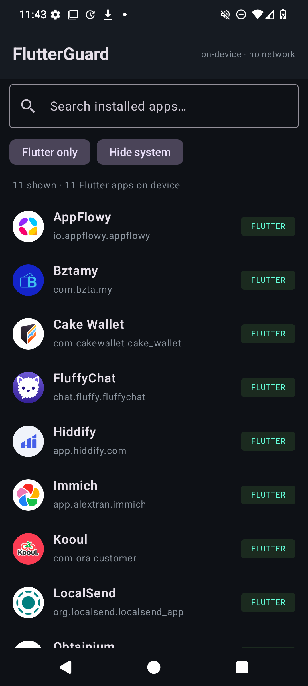
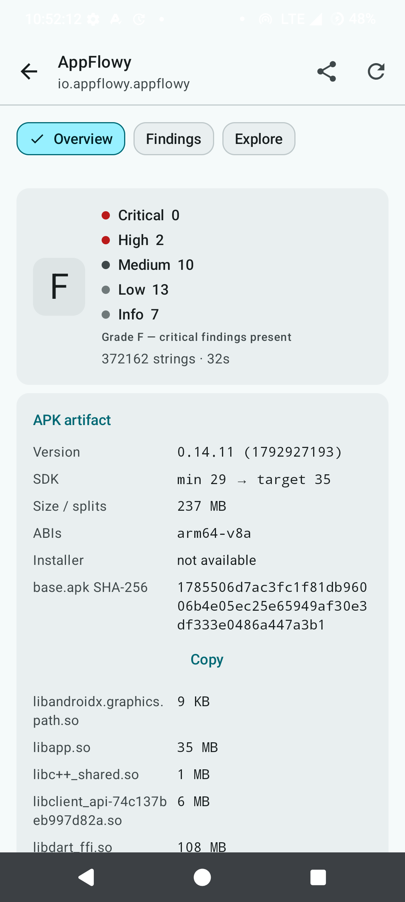
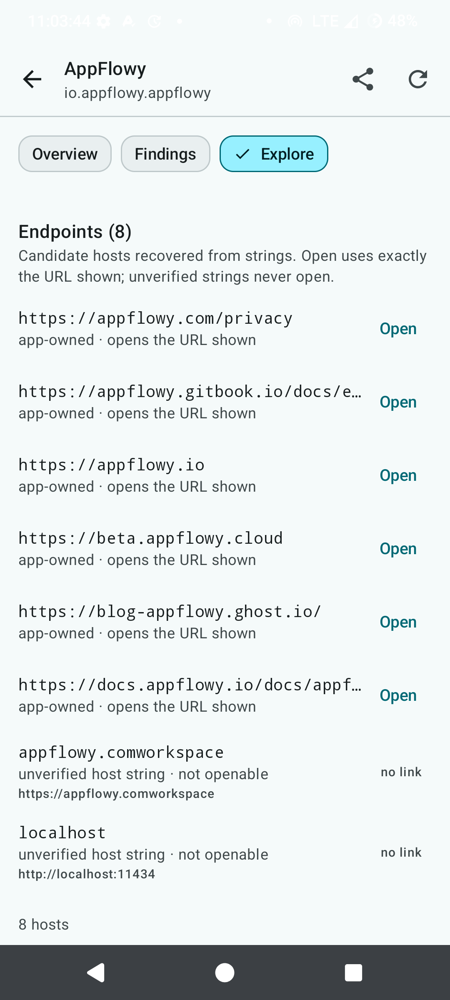
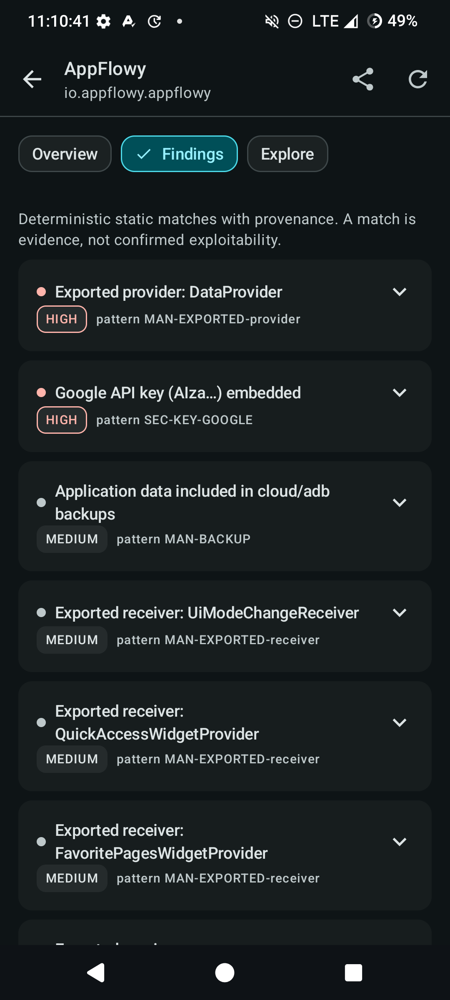

<div align="center">

# FlutterGuard

**On-device security audit for Flutter apps — no root, no PC, no network.**

Point it at any Flutter app installed on your phone and get the artifact inventory, the
manifest risk surface, the endpoints it talks to, the secrets it ships, and a graded report
you can hand to a developer or an AI agent.

[](https://github.com/anasfik/flutterguard/releases)
[](LICENSE)
[](#install)
[](#privacy)



</div>

---

## Why

Flutter apps hide their logic in `libapp.so`, ship a 100 MB Dart kernel in debug builds, and
bury API keys in assets, `resources.arsc` and native bridge libraries. The usual advice —
"decompile it on your desktop with this toolchain" — is slow, fails on obfuscated AOT
snapshots, and needs a matching Dart SDK.

FlutterGuard does the part that works from the phone: it reads the APK the OS already exposes,
parses the formats that matter (binary XML, `resources.arsc`, DEX strings, `libapp.so` string
pool, `kernel_blob.bin`, `NOTICES.Z`, env files, X.509 blobs), and produces a report with
evidence — all offline, no root, no interception.

It is built to be **run repeatedly**: every scan is stamped and kept, so the second scan tells
you what changed between two versions of the same app. That diff is where the real findings are.

## Screenshots

| Inventory | Report grade + artifact | Explore |
|---|---|---|
|  |  |  |

| Findings (dark) |
|---|
|  |

## What it finds

**Artifact** — package, version, SDK range, ABIs, size, split count, base APK hash, every native
library with its size and SHA-256 prefix, installer, signing scheme (v1/v2/v3/v4), signer DN and
certificate fingerprints, debug-certificate detection.

**Flutter specifics** — is this really Flutter, AOT or debug (JIT kernel), `kernel_blob.bin` size,
JIT snapshot presence, Dart engine version, obfuscation state, Dart package inventory recovered from
`NOTICES.Z` and `package:` URIs, and a fingerprint you can hand to a desktop follow-up
(Blutter/reFlutter need the exact engine build).

**Manifest risk** — permissions, exported activities/services/receivers/providers, debuggable,
backup, cleartext policy, network security config (base-config vs domain-config, loopback-only
cleartext, user-CA trust, pin sets, debug-overrides), deep links aggregated per scheme.

**Secrets and endpoints** — API keys (Google, AWS, Stripe, Supabase, Sentry, Firebase, OpenAI,
GitHub, Slack, Sendgrid, Telegram), OAuth client IDs, JWT-like blobs, DB/broker URIs with inline
credentials, private key blocks with a real body, embedded X.509 certificates (assembled from PEM
body lines when a dump splits them), Dart `--dart-define` names, and `.env`/`.env.prod` files with
credential counts.

**Endpoints** — hosts across sources, classified `first-party` / `staging` / `internal` / `saas:X` /
`ip-literal`, endpoint lists from YAML/TOML service configs (`uri: btc-electrum.example:50002`
style), API routes from the Dart snapshot, recovered source paths, WebView risk flags,
MethodChannel inventory split into `app` / `plugin` / `standard`.

**Native surface** — `flutter_rust_bridge` and other FFI bridges, JNI `Java_*` entry point count.

**Third-party and AI surface** — the SDK fingerprint table covers ~135 services, each matched by
zip path, DEX descriptor, pub package or host: everything from Firebase, Play Services, billing,
ads and attribution to auth (Auth0, Clerk, Appwrite, Stytch, WorkOS), realtime (Agora, LiveKit,
Stream, Sendbird), payments (Stripe, RevenueCat, PayPal, Paddle), backends (PocketBase, Nhost,
Supabase) and vector stores. Large language model providers are inventoried individually —
OpenAI, Anthropic, Gemini, Groq, Mistral, Cohere, DeepSeek, OpenRouter, Together, Fireworks,
Perplexity, xAI, HuggingFace, Replicate, Bedrock, DashScope, Moonshot, GLM, MiniMax, ElevenLabs,
Stability — plus on-device runtimes signalled by `localhost:11434` (Ollama) and `localhost:1234`
(LM Studio) and ComfyUI's `:8188`. The same pass names the ad, analytics and crash SDKs an app
ships, which is usually the most surprising part of a report.

**SDK marker files and bundled config** — root-level `billing.properties`,
`play-services-*.properties`, `transport-*.properties` and `firebase-encoders*.properties` name the
SDK they prove without parsing DEX; bundled `.env`/`.json`/`.yaml`/`.properties`/`.sqlite` and
key material are listed as config surface; bundled HTML/JS pages are reported as a WebView payload
so a local page rendered with a JS bridge is visible rather than implied.

**Exact versions when the APK still has its `pubspec.yaml`** — some release builds keep the
project's own dependency manifest, which yields real names *and* constraints instead of recovered
candidates. When it is absent the candidate list from `NOTICES.Z` and `package:` URIs is used.

## Install

Download the signed APK from [Releases](https://github.com/anasfik/flutterguard/releases) and
sideload it. Android 8.0+ (API 26). No Play Services required.

The app declares only package-visibility permissions so it can see the other apps on the device.
It has **no `INTERNET` permission** — every check is local, and nothing can leave the phone even
by accident.

## Use

1. Open FlutterGuard — it lists the Flutter apps installed on the device (detection is done from
   the APK contents, not from a manifest flag, so it also works on obfuscated and split APKs).
   The inventory stays loaded while you move between screens; pull the refresh action to rescan it.
2. Tap one. A staged progress stepper shows the real pipeline (artifact → manifest → DEX strings →
   native libraries → Dart kernel → assets). The scan runs in a foreground service, so leaving the
   screen does not cancel it; a terminal notification tells you when it finished.
3. Read the report across three panes:
   - **Overview** — grade, severity summary, artifact + extraction/Flutter-check metadata,
     signing, and *Changes since last scan*.
   - **Findings** — severity-sorted findings with masked evidence and the matched value.
     Tap *Reveal* on a row to see a value in place; nothing is revealed by default.
   - **Explore** — endpoints (only openable when the URL is the one displayed), the candidate
     route tree, dependencies with validated `pub.dev` links, recovered paths, channels, and the
     APK artifact browser with bounded, provenance-aware previews.
4. Long sections (routes, paths, dependencies) render a capped window with **See all** opening a
   searchable full-screen list rather than one endless scroll.
5. **Export** writes JSON or Markdown for the sections you tick. Sensitive values stay masked
   unless you explicitly opt in for that export.
6. Scan the next version of the same app and compare — the change card lists added/removed hosts,
   routes, dependencies and findings. Every scan is appended to the app's version log, bounded and
   atomic.

### Scan many apps

*Advanced → Scan all Flutter apps* queues every detected Flutter app, one at a time, behind a
confirmation dialog that states the cost. The queue screen shows a determinate bar, per-app live
stage and percentage, and per-app completion; a finished row opens that app's report, and *Cancel*
asks for confirmation before stopping the run. A per-app timeout prevents one wedged scan from
stalling the queue.

### Headless (batch / CI)

```bash
adb shell am start -n com.flutterguard.app/.MainActivity -e scan com.example.app
adb logcat -d | grep FG_REPORT
# Reports live in internal storage; pull one from a debug build (release builds are not debuggable).
adb exec-out run-as com.flutterguard.app cat files/reports/com_example_app.json > com_example_app.json
```

A `<package>.hist` snapshot is written next to every report; it is what powers the diff.

## Grades

`A` clean, `C` well-built app with a few hardening gaps, `F` failed on something fundamental
(debug build shipped, debug cert, cleartext everywhere, or shipped credentials). It is a triage
label, not a score — read the findings, not the letter.

## Corpus

Every detector in this project exists because a real app exposed the gap. `CORPUS.md` records the
manual finding that produced each rule, from eleven Flutter apps plus one non-Flutter negative
control:

| App | Grade | Nothing-special? |
|---|---|---|
| RustDesk, LocalSend, Hiddify | C / D | well-built baselines that must stay clean |
| Immich, Obtainium | D / F | NSC semantics, user-CA trust, cleartext base-config |
| Cake Wallet | D | scheme-less endpoint lists, pinned X.509, 123 JNI symbols |
| FluffyChat | F | PEM-line certificate reassembly, `.arsc`-only Google key |
| Spotube, AppFlowy | F | OpenSSL PEM labels that look like keys but are not |
| Kooul | F | plaintext `.env.prod` with 13 credentials |
| Bztamy | F | 113 MB JIT kernel, debug cert, debug build |
| Primal | D | negative control: correctly identified as *not* Flutter |

## Also a skill

`skill/SKILL.md` turns FlutterGuard into an audit workflow for coding agents (Claude Code, Codex,
OpenClaw, …): how to run the app for repeatable and version-diff scans, and when to drop to a
desktop toolchain for decompilation, AAB inspection, or real signature verification.
`docs/METHODOLOGY.md` explains how each detector was derived from a manual observation.

## Build

```bash
git clone https://github.com/anasfik/flutterguard.git
cd flutterguard
echo "sdk.dir=$ANDROID_HOME" > local.properties
./gradlew assembleRelease        # signed APK in app/build/outputs/apk/release/
```

Release builds read `FG_KEYSTORE`, `FG_KEYSTORE_PASSWORD`, `FG_KEY_ALIAS`, `FG_KEY_PASSWORD`, and
fall back to `.keystore/flutterguard.jks`. Debug builds use the debug key.

## Architecture

- `scan/Scanner.kt` — the pipeline: artifact, manifest, DEX/native/kernel strings, assets, rules.
  Supports cooperative cancellation and reports progress per stage.
- `ScanService.kt` — the single scan owner (foreground `dataSync` service, one job at a time, a
  permanent per-job token so a timed-out scan can never write into a newer report). UI and
  headless entry points share it.
- `ScanStore.kt` — observable scan state machine: idle, running, done, failed, cancelled.
- `Inventory.kt` — process-scoped installed-app cache with explicit refresh; survives navigation.
- `ReportFiles.kt` — atomic report and history writes (temp file, fsync, rename) plus inflight
  markers used to explain an interrupted scan after a kill.
- `scan/Model.kt` — report model; `Evidence.value` is private and in-memory only, snippets are
  masked by construction, `scrubSecrets()` is applied before a report leaves the scanner.
- `scan/ReportExport.kt` — section-selected JSON/Markdown, default-redacted.
- `ui/` — Compose Material 3 screens, one semantic colour scheme, light and dark.

## Privacy

Reports live in the app's private storage. Export uses a non-exported `FileProvider` on
`cache/exports/`. The app cannot open a socket. Sensitive values are masked in the UI, in shared
exports, and on the clipboard (marked sensitive) unless you explicitly reveal or opt in, and
screens that can show a revealed value set `FLAG_SECURE` while they are up. Treat any report you
export with sensitive values as sensitive.

## Limits

Honest scope, because a tool that overstates itself is worse than none:

- Reads artifacts only. No runtime hooking, no traffic interception, no `/data/data` of other apps.
- `libapp.so` is AOT machine code; the report gives strings, symbols and routes, not decompiled
  Dart. Use a desktop toolchain with the matching engine build for that.
- Recovered routes are candidate strings grouped by prefix — not a navigation graph, and not proof
  that a screen exists.
- AABs are not supported — expand to APKs with `bundletool` first.
- Signature verification is structural (schemes, signer identity), not a full `apksigner` check.
- Some ROMs block APK reads for other apps; that is an OS policy, not a FlutterGuard setting.

## Legal

Only scan apps you own or have written permission to test. FlutterGuard is an audit aid for
developers, security researchers and bug-bounty participants working within scope.

## Maintainer

Built by [Anas Fikhi](https://github.com/anasfik). Issues and corpus submissions are welcome —
if you find a Flutter app that breaks a heuristic, open an issue with the report.

<div align="center"><sub>MIT licensed · offline by design</sub></div>
